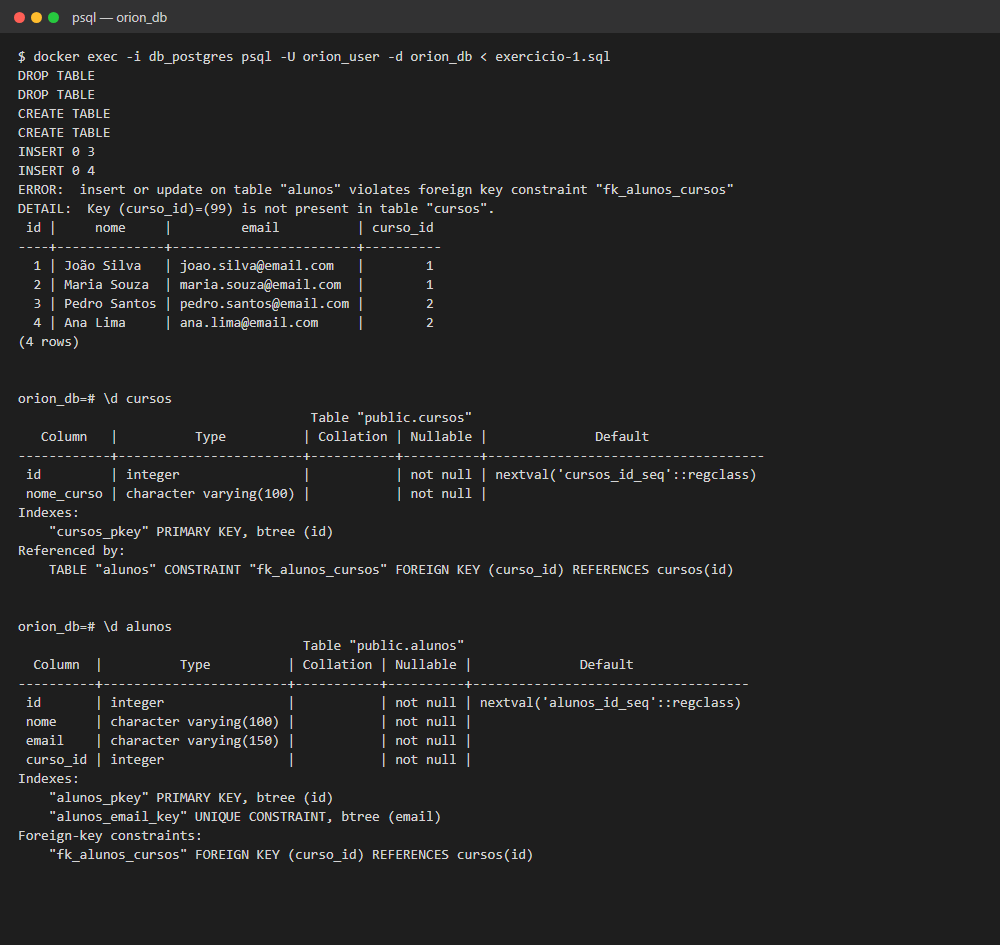
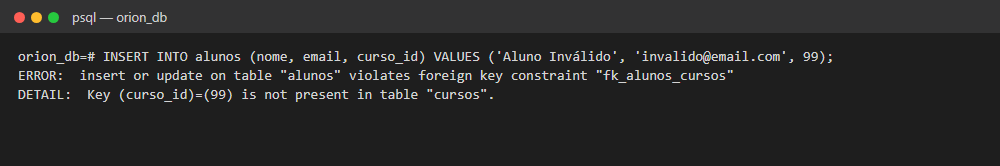
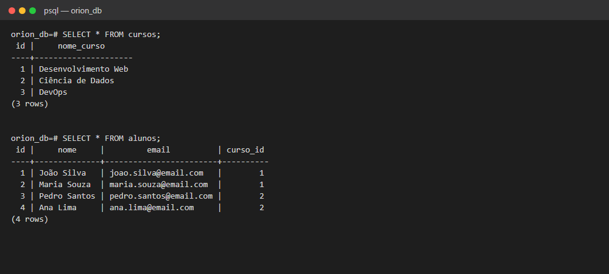

# Exercício 1 — Banco relacional (SQL Básico)

Criação das tabelas `cursos` e `alunos` no PostgreSQL, com chave primária, chave estrangeira e dados de teste.

## Como rodar

Com o ambiente da pasta `banco-de-dados/` no ar:

```bash
docker exec -i db_postgres psql -U orion_user -d orion_db < exercicio-1.sql
```

O script apaga e recria as tabelas, então pode ser executado várias vezes.

## O que o script faz

| Etapa | Comando |
|---|---|
| Tabela `cursos` com `id` (chave primária) e `nome_curso` | `CREATE TABLE` |
| Tabela `alunos` com `id`, `nome`, `email` e `curso_id` (chave estrangeira para `cursos.id`) | `CREATE TABLE` |
| 3 cursos e 4 alunos ligados aos cursos | `INSERT` |
| Tentativa de inserir um aluno com `curso_id = 99`, que não existe | `INSERT` (deve falhar) |
| Lista todos os alunos | `SELECT * FROM alunos;` |

## Critérios de sucesso

**1. `CREATE TABLE` executa sem erros:** as duas tabelas são criadas, e o `\d` mostra as chaves.



**2. A chave estrangeira impede um aluno com `curso_id` inexistente:** o banco recusa o curso 99.



**3. `SELECT * FROM alunos;` retorna todos os alunos inseridos.**


