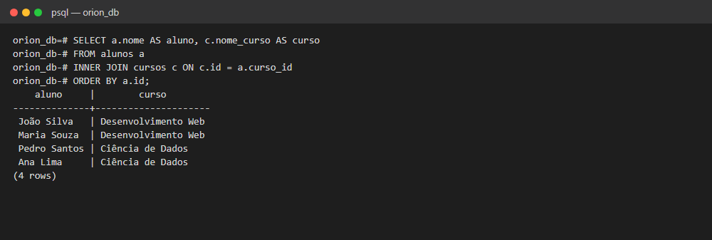
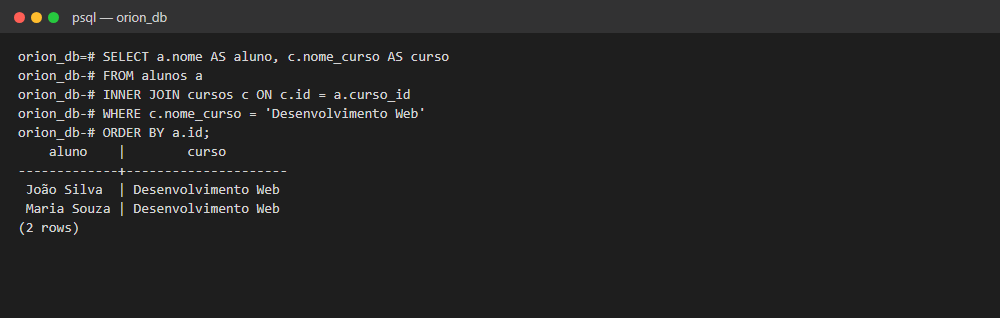
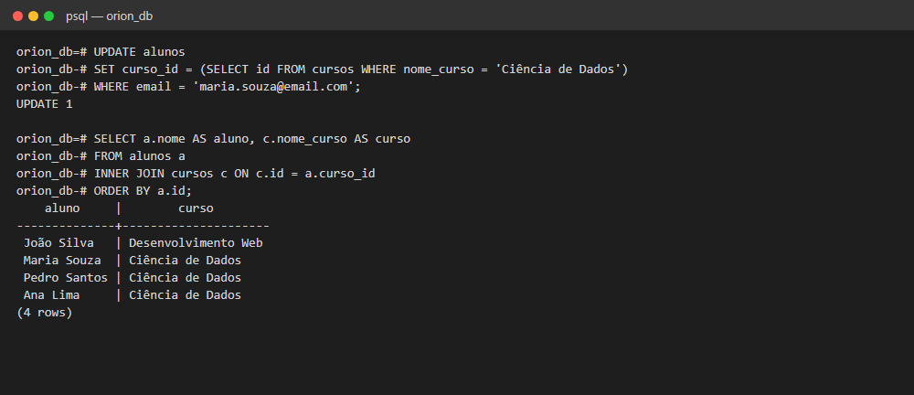
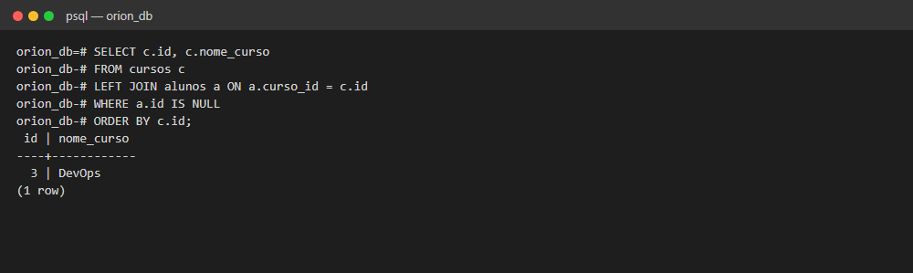

# Exercício 2 — Banco relacional (JOINs e Filtros)

Consultas que combinam as tabelas `alunos` e `cursos` do Exercício 1 usando `JOIN`, `WHERE` e `UPDATE`.

## Como rodar

Primeiro rode o Exercício 1, que cria as tabelas e os dados. Depois:

```bash
docker exec -i orion_postgres_db psql -U orion_user -d orion_db < exercicio-2.sql
```

## O que o script faz

| Etapa | Comando |
|---|---|
| Nome do aluno e nome do curso em uma única consulta | `INNER JOIN` |
| Apenas os alunos de Desenvolvimento Web | `INNER JOIN` + `WHERE` |
| Move a Maria para Ciência de Dados e confere com um novo `SELECT` | `UPDATE` |
| Extra: cursos que não têm nenhum aluno | `LEFT JOIN` + `WHERE ... IS NULL` |

## Critérios de sucesso

**1. A consulta com `JOIN` retorna os nomes corretos** (ex.: "João Silva", "Desenvolvimento Web").



**2. A consulta com `WHERE` filtra corretamente os alunos:** só aparecem os de Desenvolvimento Web.



**3. O `UPDATE` funciona, e um novo `SELECT` com `JOIN` mostra a mudança:** Maria passa para Ciência de Dados.



**Extra: `LEFT JOIN` mostra os cursos sem alunos matriculados.** O resultado é DevOps.


