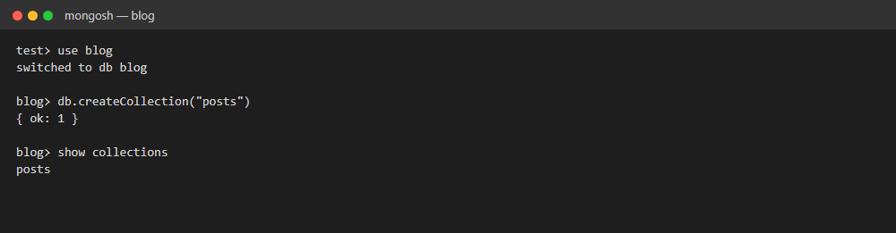
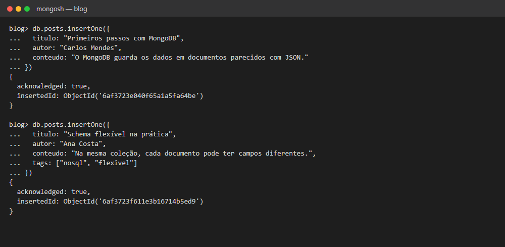
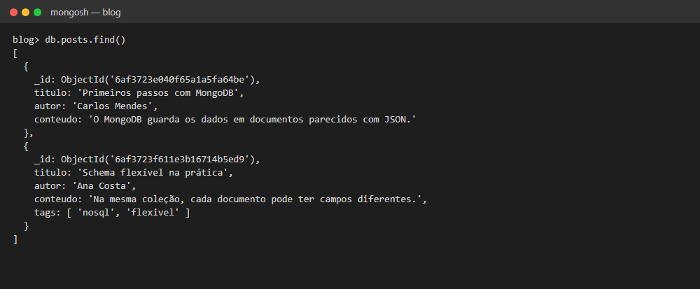

# Exercício 3 — Não relacional (CRUD Básico)

Coleção `posts` de um blog no MongoDB, com documentos de formatos diferentes para mostrar o schema flexível.

## Como rodar

Com o ambiente da pasta `banco-de-dados/` no ar:

```bash
docker exec -i db_mongo mongosh -u orion_admin -p orion_admin_pass --quiet --file /dev/stdin < exercicio-3.js
```

O script usa o banco `blog` e apaga a coleção `posts` no começo, então pode ser executado várias vezes.

## O que o script faz

| Etapa | Comando |
|---|---|
| Cria a coleção `posts` | `db.createCollection("posts")` |
| Insere um post com `titulo`, `autor` e `conteudo` | `insertOne()` |
| Insere um segundo post com os mesmos campos e mais `tags` (array) | `insertOne()` |
| Lista todos os posts | `find()` |

## Critérios de sucesso

A coleção `posts` foi criada no banco `blog`:



Os dois documentos foram inseridos, o segundo com o campo novo `tags`:



**`find()` retorna os dois documentos. O segundo tem `tags` e o primeiro não**, o que prova que o banco aceitou estruturas diferentes na mesma coleção:


