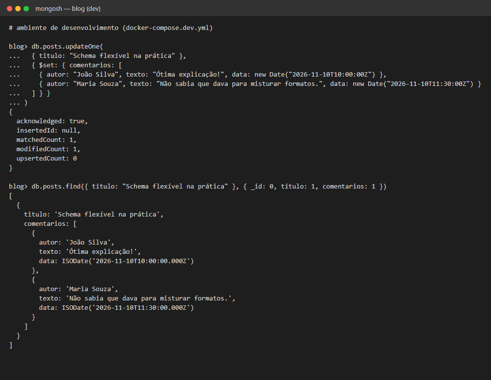
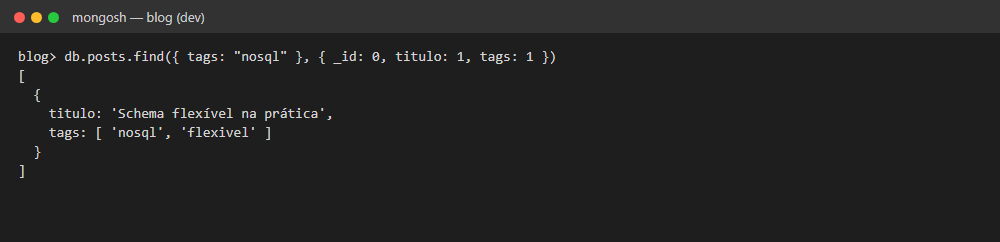
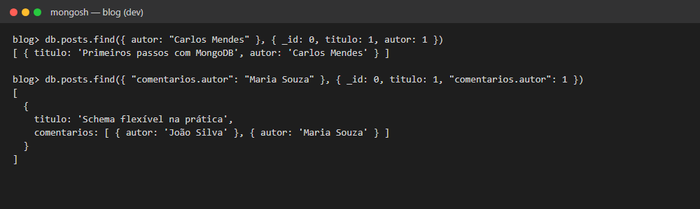
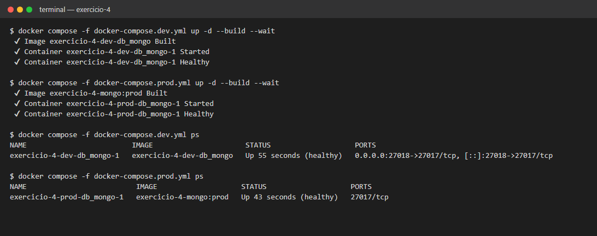
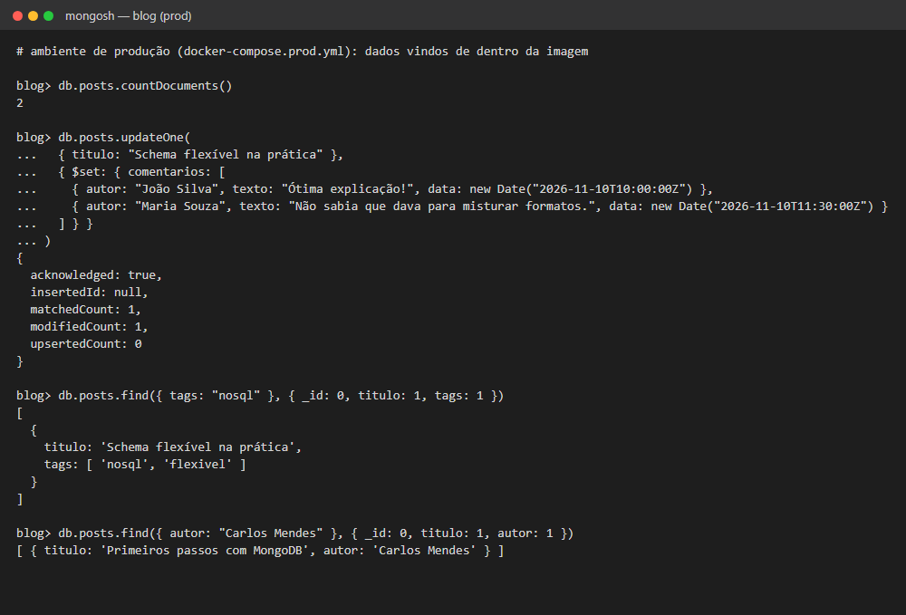

# Exercício 4 — Não relacional (Consultas Avançadas)

Consultas no MongoDB com `updateOne()`, filtros dentro de arrays e de documentos aninhados, e dois ambientes (dev e prod) com Docker Compose.

## Estrutura

```
exercicio-4/
├── exercicio-4.js            # updateOne + consultas do exercício
├── scripts/
│   └── 01-posts.js           # carga inicial: os posts do Exercício 3
├── Dockerfile                # multi-stage: estágios dev e prod
├── .dockerignore
├── docker-compose.dev.yml
├── docker-compose.prod.yml
└── prints/
```

## Ambientes

| | Dev | Prod |
|---|---|---|
| Arquivo | `docker-compose.dev.yml` | `docker-compose.prod.yml` |
| Estágio do Dockerfile | `dev` | `prod` |
| Scripts de carga | Montados por volume da pasta local `./scripts` | Copiados para dentro da imagem |
| Volumes | Pasta `scripts/` + volume nomeado `dados-dev` | Nenhum volume montado |
| Porta | `27018` no computador (a `27017` já é do ambiente geral) | Não publicada, acessível só pela rede do Docker |
| Imagem | Construída na hora | `exercicio-4-mongo:prod` |

Cada arquivo tem o próprio `name:` (`exercicio-4-dev` e `exercicio-4-prod`), então os dois ambientes rodam ao mesmo tempo, com containers, redes e dados separados.

A imagem base é a oficial `mongo:7`. Não existe versão oficial "alpine" do MongoDB, então a otimização está em não adicionar nada além do necessário: o estágio `prod` acrescenta só uma camada de cerca de 12 kB, com os scripts de carga, e o `.dockerignore` deixa README, prints e arquivos do Compose fora do build.

## Como rodar

```bash
# Desenvolvimento
docker compose -f docker-compose.dev.yml up -d --build
docker compose -f docker-compose.dev.yml exec -T db_mongo mongosh -u orion_admin -p orion_admin_pass --quiet --file /dev/stdin < exercicio-4.js

# Produção
docker compose -f docker-compose.prod.yml up -d --build
docker compose -f docker-compose.prod.yml exec -T db_mongo mongosh -u orion_admin -p orion_admin_pass --quiet --file /dev/stdin < exercicio-4.js
```

Na primeira vez que sobe, cada ambiente carrega os posts do Exercício 3 automaticamente.

Também dá para rodar o `exercicio-4.js` no ambiente geral da pasta `banco-de-dados/`, depois do Exercício 3.

## O que o script faz

| Etapa | Comando |
|---|---|
| Adiciona `comentarios` (array de documentos) a um post | `updateOne()` com `$set` |
| Posts com a tag "nosql" (consulta dentro de um array) | `find({ tags: "nosql" })` |
| Posts de um autor específico | `find({ autor: "Carlos Mendes" })` |
| Extra: posts com comentário de uma pessoa (consulta em documento aninhado) | `find({ "comentarios.autor": "Maria Souza" })` |

## Prints

**`updateOne()`** adicionando o array `comentarios`:



**Consulta dentro do array** `tags`:



**Filtro por autor e consulta dentro dos comentários**:



**Dev e prod rodando ao mesmo tempo**, de forma independente:



**Teste no ambiente de produção**, com os dados carregados de dentro da imagem:


